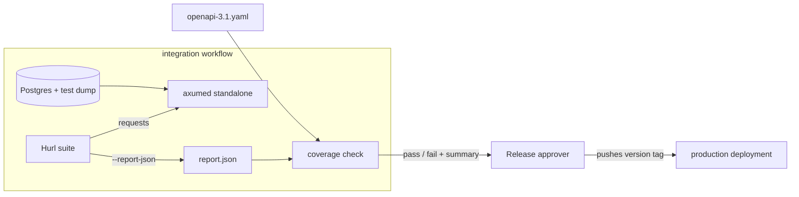

# Design: Hurl API Coverage

Feature #0001: hurl-api-coverage. Implements
[requirements.md](./requirements.md).

## Overview

The design has four parts:

1. **Specification reconciliation**: a catalog of every mismatch found between
   `openapi-3.1.yaml` and the running API, each with a proposed resolution to
   approve case by case (US-3).
2. **Hurl suite**: fixed and extended test files in the current layout, using
   run-unique data and one variables file per environment (US-1, US-2, US-5).
3. **Coverage check**: a script comparing the Hurl run report with the
   specification (US-4).
4. **CI and release approval**: the `integration` workflow runs everything on
   each pull request; a senior engineer or manager reviews the results and
   triggers the release manually (US-6).



## Discovery Method

Findings below come from running the existing suite and targeted probes against
the standalone server (`axumed`) and a database loaded from
`database-with-test-data.sql`, on 2026-10-19, at version `1.6.0-alpha.1`. Each
finding was confirmed against the source where noted.

Existing suite results: all nine Hurl files pass on a fresh database. On a
second run, `scenario/bna-pipeline.hurl` fails with a 500 because it reuses a
fixed `state_machine_id`.

## 1. Mismatch Catalog

Each entry lists the observed behavior, the specification, and its resolution.
**All resolutions M-01 to M-27 were approved by the team on 2026-10-19**, as
proposed (the alternative noted under M-07 was not retained). M-28 and M-29 were
found during implementation and are pending approval. `Code` means the
implementation changes; `Spec` means the specification changes (through the
`utoipa` annotations, then `just regenerate-all-no-cargo`). Entries marked
**client-visible** change behavior for API consumers and must be called out in
the release notes.

### Cross-cutting

- **M-01 Error body format.** Requests rejected by Axum extractors (invalid path
  or query values, malformed JSON, missing fields) return `text/plain` messages.
  The specification documents `APIErrors` JSON for every error. Proposed:
  **Code**, convert every extractor rejection into an `APIErrors` body, with
  `source.parameter` for query errors and `source.pointer` for body or path
  errors. Client-visible.
- **M-02 Status for invalid bodies.** Missing or mistyped body fields return
  422; syntactically invalid JSON returns 400. The specification only
  documents 400. Proposed: **Code**, return 400 for both, matching the
  specification's existing 400 description ("formatted incorrectly or missing
  required parameters"). Client-visible.
- **M-03 Undocumented 500 on invalid input.** Several invalid requests reach the
  database and return 500 "Database error" with empty details (M-14 to M-18).
  Proposed: **Code**, validate before writing so that client mistakes never
  produce 500. The coverage check treats any 500 as a failure.
- **M-04 Unreachable documented codes.** Most operations list 400, 401, 403 and
  404 whether or not they can happen. Proposed: **Spec**, remove 401 and 403
  everywhere (produced by API Gateway, out of scope), and remove 400 or 404
  wherever no input can trigger them, based on the final behavior after the
  other fixes.

### Pagination

- **M-05 First page index.** The code is zero-based (`page=0` and `page=1`
  return different items) while the specification declares `minimum: 1` and the
  code comments say pages start at 1. The navigation headers already assume
  1-based pages (`x-prev-page: 1` on page 0). Proposed: **Code**, make pages
  1-based, default `page=1`, reject `page=0` with 400. Client-visible.
- **M-06 Out-of-range `page`.** `page=70000` is accepted although the
  specification sets `maximum: 65536`. Proposed: **Code**, reject with 400.
- **M-07 Out-of-range `page_size`.** `page_size=0` silently becomes 1 and
  `page_size=150` silently becomes 100, while the specification declares 1
  to 100. Proposed: **Code**, reject out-of-range values with 400.
  Client-visible. Alternative: keep clamping and remove the bounds from the
  specification.
- **M-08 Wrong totals.** `GET /cities` and `GET /usstates` return `x-total: 1`
  and `x-total-pages: 1` while the database holds 11 cities and 52 US states
  (including District of Columbia and Puerto Rico). Proposed: **Code**, fix the
  counts.
- **M-09 Missing pagination headers.** `GET /pipelines/bna` accepts `page` and
  `page_size` but returns no `x-*` pagination headers or `link` header, unlike
  every other list. Proposed: **Code**, return the standard headers.
- **M-10 Pages past the end.** A page after the last returns 200 with an empty
  list. Proposed: **Spec**, document this behavior (keep it).

### Query parameters

- **M-11 Unknown `sort_by`.** Unknown values are silently ignored. Proposed:
  **Code + Spec**, declare the allowed values per operation as an enum and
  reject others with 400.
- **M-12 Ignored `latest`.** `latest` has no effect on `GET /cities` and
  `GET /cities/summary/latest` (verified: the cities adaptor never reads it). It
  works on `GET /prices/fargate`. Proposed: **Spec**, remove the parameter from
  the two city operations.
- **M-13 Free-form submission `status`.** `status=Bogus` returns 200 with an
  empty list. Valid values are `Pending`, `Approved`, `Rejected`. Proposed:
  **Code + Spec**, make it an enum and reject unknown values with 400.

### Cities and submissions

- **M-14 Duplicate city.** Posting an existing city returns 500. Proposed:
  **Code + Spec**, return and document 409 Conflict.
- **M-33 Wrong region for new US cities.** `POST /cities` for a US city stores
  the country name (`United States`) as its region instead of the BNA region
  from the state crosswalk (for example `South` for Tennessee): the crosswalk
  region is set, then overwritten because the request has no region. Found while
  testing city creation. Resolution: **Code**, only default the region to the
  country for non-US cities. Cities created before the fix keep the wrong
  region.
- **M-15 Unknown country on create.** `POST /cities` with an unknown country
  returns 500. Proposed: **Code**, return 400.
- **M-34 Unknown US state on create.** `POST /cities` for a US city with a state
  outside the crosswalk returns 500. Found with M-15. Resolution: **Code**,
  return 400 pointing at `/state`. Covered by the approved M-03 rule.
- **M-16 Unknown country on read.** `GET /cities/{country}/...` with a country
  outside the `Country` enum returns 404. Proposed: **Code**, return 400, as for
  any other invalid enum value.
- **M-17 Broken submission update.** `PATCH /cities/submissions/{id}` always
  returns 400 because the handler reads the ID from the query string instead of
  the path (verified: `Query(submission_id)` in
  `lambdas/src/core/resource/cities/endpoint.rs`). The operation is currently
  unusable. Proposed: **Code**, read the path parameter.
- **M-30 Unknown submission on update.** Updating a submission that does not
  exist returns 500 "Database error". Found once M-17 made the operation usable.
  Resolution: **Code**, return 404, as documented, including for an update
  without any change (SeaORM then reports the row as not found rather than not
  updated; the same applies to pipelines, M-23). Covered by the approved M-03
  rule (client mistakes never produce 500).
- **M-31 Unknown status on submission update.** Updating a submission with a
  `status` outside `Approved`, `Pending`, `Rejected` returns 500 "Database
  error". Resolution: **Code + Spec**, type the status as the `ApprovalStatus`
  enum (M-13) so unknown values are rejected with 400. Covered by the approved
  M-03 rule.
- **M-32 Partial submission update documented as full.** The `SubmissionPatch`
  schema marks every field as required, while the API accepts any subset of
  fields. Found with M-31. Proposed: **Spec**, make every field optional.
  **Pending approval.**
- **M-40 Ignored submission status on create.** The `SubmissionPost` schema
  marks `status` as required, but the API ignores it and always creates the
  submission as `Pending`; the tests omit it. Found while checking the request
  bodies against the specification (phase 12). Proposed: **Spec**, remove
  `status` from `SubmissionPost`. **Pending approval.**
- **M-18 Broken submission status filter.** `GET /cities/submissions/{id}` with
  `?status=...` always returns 400 (the whole query string is deserialized as a
  single string). Proposed: **Code**, fix the extractor.
- **M-41 Navigation headers.** Every list returns an empty `link` header, and
  the navigation headers clamp instead of describing the requested page: page 1
  reports `x-prev-page: 1`, the last page reports itself as `x-next-page`, and a
  page past the last one reports `x-prev-page: 1` and the last page as
  `x-next-page` (for example `x-page: 999`, `x-next-page: 1`). The specification
  documents none of these headers. Proposed: decide whether to fill the `link`
  header or remove it, then document the headers and their values at the edges.
  **Pending decision.**
- **M-35 Latest summaries count cities without a rating.**
  `GET /cities/summary/latest` counts every city in `x-total`, then drops the
  cities without a rating from the page, so pages can hold fewer items than
  `page_size` and the totals overcount. Found while adding city creation tests,
  which create cities without ratings. Proposed: **Code**, count and page only
  the cities with a rating. **Pending approval.**
- **M-37 City ratings past the last page.**
  `GET /cities/{country}/{region}/{name}/ratings` with a page past the last one
  returns 404 "cannot find a city", although the city exists and the
  specification says such a page is empty. Found while reviewing the documented
  codes (phase 9). Resolution: **Code**, look the city up first (404 only when
  it does not exist) and return it with an empty `ratings` list. Fixed under the
  rule that the implementation matches the specification. Like M-35, a city
  without ratings still counts one item in `x-total`.
- **M-38 Unknown country on a new submission.** `POST /cities/submissions` with
  a country outside the `Country` enum returns 500: the insert fails on the
  country foreign key. Found while reviewing the documented codes (phase 9).
  Resolution: **Code**, return 400 pointing at `/country`, like `POST /cities`
  (M-15). Covered by the approved M-03 rule. The commented-out check on the
  countries covered by the BNA, still under discussion, is left as is.
- **M-19 Top cities bounds.** `/cities/top/{year}/{count}` returns 404 for years
  outside 2017–2029 and accepts `count=0` and `count=101` despite the
  specification's bounds. Proposed: **Code**, return 400 for any out-of-range
  value. Client-visible.

### Ratings

- **M-20 Rating for an unknown city.** `POST /ratings` with an unknown `city_id`
  returns 500. Proposed: **Code**, return 400 with `source.pointer` `/city_id`.
- **M-29 Measures never returned.** `GET /ratings/{rating_id}` (and every other
  rating read) returns `measure` with all fields `null`, even when the rating
  has a measure row: the read queries join the seven other rating detail tables
  but not `measure` (verified in `lambdas/src/core/resource/ratings/db.rs`).
  Only `POST /ratings` echoes the measure it inserted. Found while loading the
  fixtures. Proposed: **Code**, include the measure in every rating read (left
  join, since older ratings have none). Client-visible. **Pending approval.**

### Pipelines

- **M-21 `sqs_message` type.** The specification declares a string. The API
  stores JSON: an object sent in the request is stored and returned as a
  stringified object, and a string sent in the request is double-encoded (`"{}"`
  comes back as `"\"{}\""`). Proposed: **Code + Spec**, declare and return
  `sqs_message` as a JSON object, in requests and responses. Client-visible.
- **M-22 Duplicate pipeline.** Posting an existing `state_machine_id`
  returns 500. Proposed: **Code + Spec**, return and document 409 Conflict.
- **M-23 Unknown pipeline on update.** `PATCH /pipelines/bna/{id}` for an
  unknown ID returns 500. Proposed: **Code**, return 404.
- **M-24 Invalid enum on update.** An unknown `status` value in the PATCH body
  returns 500. Proposed: **Code**, return 400 (covered by M-01/M-02 once the
  body is deserialized into the enum).
- **M-28 Pipeline steps disagree with the database.** The specification and the
  code define the steps `SqsMessage`, `Setup`, `Analysis`, `Cleanup`, while the
  `bna_pipeline_step` table (filled by the migrations) holds `Setup`,
  `Analysis`, `Save`, `Cleanup`. Creating or updating a pipeline with
  `SqsMessage` fails on the foreign key, and `Save` cannot be expressed through
  the API. Found while loading the fixtures. Proposed: **Code**, a migration so
  the table holds exactly the API's steps, unless the pipeline state machine
  really uses `Save`, in which case the API gains it instead. **Pending
  approval; needs confirmation from the pipeline owners.** Since M-24, the
  update body is checked against the API's steps (the unused `BNAPipelineStep`
  enum in `entity/src/wrappers/mod.rs` now lists them), so `Save` is rejected
  with 400 instead of being stored, which would break every later read of the
  pipeline. `SqsMessage` still fails on the foreign key.
- **M-25 Ignored `start_time` on update.** `BnaPipelinePatch` documents
  `start_time`, but the update never applies it (verified:
  `start_time: ActiveValue::NotSet` in `entity/src/wrappers/bna_pipeline.rs`).
  Proposed: **Code**, apply it when provided.
- **M-39 Partial pipeline update documented as full.** The `BnaPipelinePatch`
  schema marks `status` and `step` as required, while the API accepts any subset
  of fields (the tests update `start_time` alone). Found while checking the
  request bodies against the specification (phase 12), like M-32. Proposed:
  **Spec**, make every field optional. **Pending approval.**

### Reports and US states

- **M-26 Report year bounds.** `/reports/{year}` returns 200 with an empty body
  for years outside 2017–2029. Proposed: **Code + Spec**, return and
  document 400.
- **M-27 Case-sensitive state names.** `/usstates/texas` returns 404; only
  `Texas` matches. Proposed: **Spec**, document that the name is case sensitive
  (keep the behavior).
- **M-36 Empty scores in the reports.** Both reports leave the
  `coreservices_score`, `people`, `retail`, and `transit` columns empty on every
  row: the queries name these scores `core_services_score`, `people_score`,
  `retail_score`, and `transit_score`, which match no field of the report row.
  Found while checking the report format. Resolution: **Code**, name the query
  columns after the CSV header, which is unchanged. Fixed under the rule that
  the implementation must match its own documentation (the header promises the
  values).

### Test bugs (no API change)

- **T-01** `bna-pipeline.hurl` sends `country` URL-encoded in the body
  (`United%20States` is stored). Use a separate, non-encoded variable for
  bodies.
- **T-02** `bna-pipeline.hurl` sets `start_time` after `end_time`.
- **T-03** `pagination.hurl` comments contradict its assertions (`page=-5`,
  `page=5000`).
- **T-04** `system.hurl` comment describes Fargate prices.
- **T-05** `ratings.hurl` has an empty `[Asserts]` section; `cities.hurl`
  captures unused values.
- **T-06** `localhost.vars` defines a `city_id` that does not exist in the test
  dump and is not used.
- **T-07** `staging.vars` and the `test-staging-schemathesis` recipe in
  `lambdas/tests/justfile` target `https://api.peopleforbikes.xyz`, a domain
  that no longer exists. Staging lives at
  `https://api.staging.bna.peopleforbikes.org`, as the specification already
  states. Doc tests in `lambdas/src/lib.rs` and an event fixture in
  `lambdas/src/fixtures` also use the old domain, only as example URLs; updating
  them is optional cleanup, outside this feature.

## 2. Hurl Suite

### Layout

The current layout stays. Files and their purpose:

- `endpoints/<resource>.hurl`: one file per resource, covering each operation's
  success and error codes. New files: `pipelines.hurl`, `submissions.hurl`.
  `cities.hurl` gains `POST /cities`.
- `scenario/<flow>.hurl`: multi-step flows checking behavior across operations.
  - `pagination.hurl`: header values and navigation math on every list
    operation.
  - `bna-pipeline.hurl`: create a city, create a pipeline, move it through its
    steps, post a rating, complete the pipeline, read everything back.
  - `submission-lifecycle.hurl`: create a submission, read it, filter by status,
    approve it, check the filter results change.
  - `sorting.hurl`: `sort_by` and `order_direction` produce ordered results.
- `smoke/public.hurl`: read-only checks only. The submission creation moves to
  `scenario/submission-lifecycle.hurl`.

Each file runs on its own: any data it needs beyond the test dump, it creates
itself.

### Conventions

- Every request starts with a comment stating the expected behavior; the comment
  and assertions must agree.
- Every request asserts more than the status when the response has a body: at
  least one value that proves the behavior (a filter applied, an order, a
  created value read back).
- Error responses assert the `APIErrors` shape: `errors` count, `status`, and
  `source`.
- Reports assert the `text/csv` content type and the CSV header line.

### Run-unique data

Hurl's built-in generators provide uniqueness without extra tooling:

- `{{newUuid}}` for `state_machine_id` and as a suffix for city names, for
  example `Hurl City {{newUuid}}`, captured once and reused in later requests.
- Submissions use a unique email built the same way.

A second consecutive run passes without resetting the database (NFR
Repeatability).

### Variables and authentication

- `localhost.vars` and `staging.vars` keep the environment values. URL-encoded
  values used in paths (`country`) get a separate plain value for request bodies
  (T-01).
- A `token` variable is sent as `Authorization: Bearer {{token}}` on write
  requests. It is never committed: CI and developers pass it with
  `--variable token=...` or the `HURL_VARIABLE_token` environment variable.
  Locally it is empty and ignored by the standalone server.
- `staging.vars` points at `https://api.staging.bna.peopleforbikes.org` (T-07).

### Test data

Current dump (profiled on 2026-10-19): schema up to date with all four
migrations, 11 cities (10 US, 1 Canada), 67 complete ratings spread over
2017–2025 (Chattanooga has 12), 52 US states, and 1 Fargate price. It has no
pipelines, no submissions, and no measures; 2017–2020 have only 1 or 2 rated
cities each. It was produced by `just dbdump`, a `pg_dump` of whatever a local
database held, so it cannot be reproduced.

The dump becomes the output of a committed, reproducible recipe:

1. Migrations: create the schema from scratch. The migrations already fill the
   lookup tables (countries, regions, US states, crosswalk, statuses, steps,
   bike lane types) and the first Fargate price.
2. Baseline: load a committed, data-only SQL file holding the current dump's
   test data (`city`, `summary`, and the seven rating detail tables). It is
   extracted once from today's dump and then maintained by hand.
3. Fixtures: apply a small, hand-written SQL file committed next to the dump,
   adding only what read-only tests need:
   - 3 pipelines: one `Pending`, one `Processing`, one `Completed` with cost and
     end time.
   - 3 submissions: one per status (`Pending`, `Approved`, `Rejected`).
   - 3 Fargate prices with distinct dates and values.
   - Measures on at least 2 ratings.
   - 1 city in a country without regions (region equals the country name).
   - Enough cities rated in one early year to test top-N with N of 5.
4. `pg_dump` into `database-with-test-data.sql`.

The seeder (`examples/seeder.rs`) is not used: it keeps only the latest rating
per city, so it cannot reproduce the rating history the tests rely on (seeding
`sample-all-25.01.csv` yields 20 cities with one rating each and no 2025
ratings). Every row in the baseline and fixtures uses fixed identifiers and
timestamps, and the fixtures pin the `created_at` of the Fargate price inserted
by the migrations, so two runs of the recipe produce identical data.

The recipe runs against a dedicated database (never the developer's working
database) and is exposed as a `just` recipe in `lambdas/tests`, replacing
`dbdump`. CI keeps loading the generated dump, so test runs stay fast.

Tests that create data (run-unique) do not depend on these fixtures; the
fixtures exist only for read-only assertions, such as filters and sorting, whose
expected results must be known in advance.

## 3. Coverage Check

### Input

- `openapi-3.1.yaml`: the list of operations (method + path template) and their
  documented status codes.
- The Hurl JSON report, produced by running the suite with
  `--report-json <dir>`. For each executed request, it records the method, the
  URL, and the response status.

### Matching

Each recorded request is matched to an operation:

1. Strip the host and query string; split the path into segments.
2. Compare to every path template with the same number of segments for the same
   method. A literal segment must match exactly; a `{param}` segment matches
   anything.
3. When several templates match, the one with the most literal segments wins
   (`/cities/top/2025/5` matches `/cities/top/{year}/{count}` rather than
   `/cities/{country}/{region}/{name}`).
4. A request matching no template is reported as an unknown path.

### Output and exit code

The check prints three lists and exits non-zero if any is not empty:

- **Uncovered**: documented (operation, status) pairs never observed.
- **Undocumented**: observed (operation, status) pairs the specification does
  not document, including any 500.
- **Unknown paths**: requests that match no operation.

It also prints a coverage summary (covered pairs / documented pairs).

### Implementation

A Python script in `lambdas/tests`, run through `uv` (the project already has a
`pyproject.toml` there), using only the standard library and a YAML parser. A
`just` recipe runs the whole suite with the report enabled, then the check:

```bash
cd lambdas/tests
just test localhost        # runs every Hurl file, writes the report
just coverage              # compares the report with openapi-3.1.yaml
```

## 4. CI and Release Approval

### Pull requests

The existing `integration` workflow (`.github/workflows/integration.yml`)
already seeds Postgres and starts `axumed`. Changes:

- Run every Hurl file through the same `just` recipes used locally, so the file
  list lives in one place (today `bna-pipeline.hurl` is missing from both).
- Run the coverage check after the suite.
- Upload the Hurl report and the coverage summary as workflow artifacts and
  write the summary to the job summary page.

### Release approval

Releases are approved and triggered manually; the deployment workflow does not
change. Pushing a version tag remains the release trigger
(`.github/workflows/deployment-production.yml`), and it is the approval: a
senior engineer or manager pushes the tag only after:

- the `integration` workflow passed on the commit being tagged (suite and
  coverage check), checked from its job summary and artifacts;
- any manual verifications are done.

No automation blocks the release; the person tagging does.

## Error Handling Strategy

After reconciliation, the API follows one rule set, documented in the
specification and enforced by the suite:

- 400: anything wrong with the request (path, query, or body), always with an
  `APIErrors` body naming the source.
- 404: a well-formed request for a resource that does not exist.
- 409: creating a resource that already exists.
- 500: never expected; the coverage check fails if one is observed.

## Risks

- **Client-visible changes** (M-01, M-02, M-05, M-07, M-19, M-21): clients
  relying on zero-based pages, clamped page sizes, plain-text errors, or a
  string `sqs_message` will break. They must be listed in the release notes, and
  the internal pipeline state machine must send `sqs_message` as an object.
- **No schema validation until Schemathesis is fixed**: response shapes can
  still drift from the specification without failing the suite.
- **`bnaclient` regeneration**: every specification change regenerates the
  client; the `bnaclient` CI job fails until it is regenerated.

## Open Questions

- Approve, change, or reject the resolutions found during implementation:
  - M-28 (pipeline steps), which needs the pipeline owners to confirm whether
    the `Save` step is used;
  - M-29 (measures never returned);
  - M-32, M-39, and M-40 (request schemas requiring fields the API does not
    need): until they are resolved, some test bodies do not conform to the
    request schemas (US-1);
  - M-35 (latest summaries count);
  - M-41 (navigation headers).
