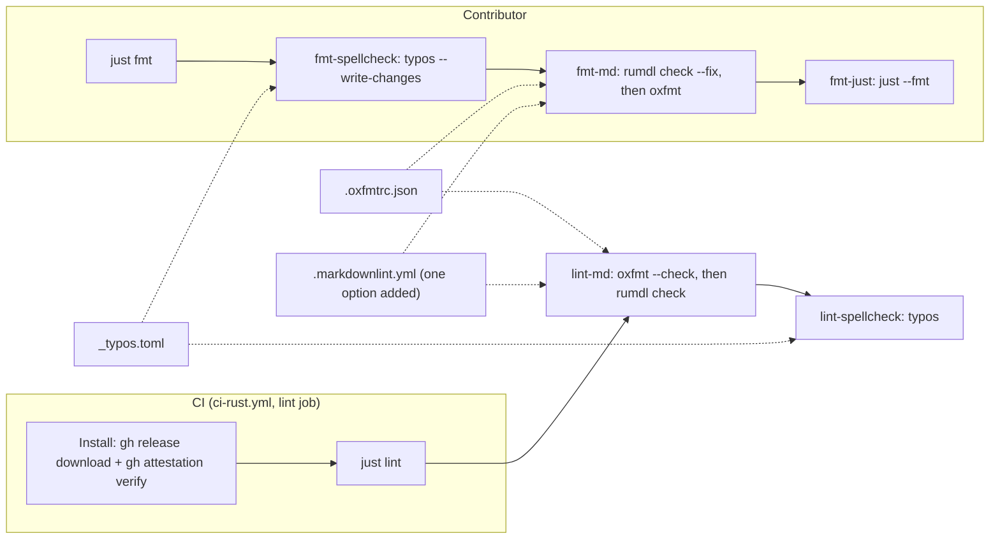

# Design Document: Rust Tooling for Markdown and Spelling

<!-- cspell:words brokenspoke oxfmt oxfmtrc rumdl rvben softwaretechnik -->
<!-- cspell:words taiki venv -->

## Overview

The three `npx` Markdown tools are replaced by three single binaries: oxfmt
formats Markdown, rumdl lints it, and typos spellchecks the whole repository.
Each one reads a small configuration file at the repository root. The `justfile`
keeps its recipe names, so contributors still type `just fmt` and `just lint`,
but the recipes now split the work cleanly: `just fmt` applies every automatic
fix (spelling corrections, lint fixes, then formatting), and `just lint` only
checks, stopping at the first failure.

CI installs the three binaries at exact versions from their GitHub releases,
verifies each archive's GitHub build attestation, and runs `just lint`. Locally
the recipes call the binaries from the `PATH`; how contributors install them is
left to the tool-manager spike (requirements, out of scope).

The rest is clean-up: the remaining `npx` packages get exact versions, the
`sql2dbml` recipes and the configuration files of the removed tools go away, the
real typos are fixed (most by `just fmt` itself), two link reference definitions
get shorter labels, and `CLAUDE.md` describes the new commands.

## Architecture



- `just fmt` runs its fixers in the order the spike verified as stable (spike
  §5.17 and its follow-up run): typos first, because a spelling correction can
  change a line's length; rumdl's fixes next; oxfmt last, so the final layout is
  always the formatter's. With the two link definitions shortened, a second
  `just fmt` changes nothing and `just lint` passes.
- `just lint` and its sub-recipes never write. `just` runs recipe lines and
  dependencies in order and stops at the first non-zero exit, which gives the
  fail-fast behavior CI needs (Requirement 4.5, 5.3) without extra code.

## Components and Interfaces

### `justfile` (root)

The Markdown and spelling recipes become:

```just
# Meta task running ALL the CI tasks at once.
ci: lint

# Meta tasks running all formatters and automatic fixes at once.
fmt: fmt-spellcheck fmt-md fmt-just

# Format the justfile.
fmt-just:
    just --fmt --unstable

# Fix the spelling mistakes that have a single correction.
# typos exits 2 when misspellings with several suggestions remain; just lint reports them.
fmt-spellcheck:
    typos --write-changes || [ $? -eq 2 ]

# Fix the fixable Markdown lint findings, then format the Markdown files.
# rumdl exits 1 when findings it cannot fix remain; just lint reports them.
fmt-md:
    rumdl check --no-cache --config .markdownlint.yml --fix . || [ $? -eq 1 ]
    oxfmt "**/*.md"

# Meta task running all the linters at once.
lint: lint-md lint-spellcheck

# Check the Markdown formatting, then lint the Markdown files.
lint-md:
    oxfmt --check "**/*.md"
    rumdl check --no-cache --config .markdownlint.yml .

# Check spelling in the whole repository.
lint-spellcheck:
    typos
```

- Each fixer tolerates only the exit code that means "something is left for a
  person", so `just fmt` still runs the next fixer: `typos --write-changes`
  exits 2 when a misspelling has several suggestions, and `rumdl check --fix`
  exits 1 when unfixable findings remain. Any other code stops `just fmt`: 127
  for a missing tool, 78 for a broken `_typos.toml`, 2 for a broken
  `.markdownlint.yml` (all measured). The remaining problems are reported by
  `just lint`. The first version used just's `-` prefix, which ignored every
  error, a missing tool included (spec review; `findings.md` §2.2).
- rumdl gets `--config .markdownlint.yml` explicitly: when it finds the file by
  itself and cannot parse it, it falls back to its defaults without a word and
  exits 0; given the path, it fails with `Config error` (`findings.md` §2.2).
- rumdl runs with `--no-cache`: by default it writes a `.rumdl_cache/` folder at
  the root, so `just lint` would modify the working tree (Requirement 4.4). It
  lints the repository in about 10 ms without a cache.
- `oxfmt "**/*.md"` restricts oxfmt to Markdown; without the glob it would also
  format the JSON, YAML and TOML files.
- No tool needs an exclude list for `target/` or `lambdas/tests/.venv/`: all
  three respect `.gitignore`, which already lists them.
- Other recipe changes:
  - `dbml-sql-print` (`justfile:91`):
    `npx -y --package=@dbml/cli@12.0.0 dbml2sql …`.
  - `dbml-svg` (`justfile:144`):
    `npx -y --package=@softwaretechnik/dbml-renderer@1.0.31 dbml-renderer …`.
  - `db-to-dbml` (`justfile:47`) and `dbml-from-sql` (`justfile:139`) are
    deleted, with their comments. Nothing else depends on them; `db-dump` stays.
  - The `entities` variable (`justfile:9`, used at `:51` and `:53`) and the
    comments at `:13` and `:30` get their spelling fixed: the variable and the
    comment at `:30` by `just fmt`, the comment at `:13` by hand (as shown
    above).

### `.oxfmtrc.json` (new, root)

```json
{
  "printWidth": 80,
  "proseWrap": "always"
}
```

oxfmt finds this file in the working directory by itself (checked in the scratch
runs: a line was wrapped at 79 columns without `-c`). `printWidth` must be
explicit: oxfmt's default is 100, and it ignores unknown keys silently (spike
§5.4).

### `.markdownlint.yml` (one option added)

```yaml
# The formatter keeps a blank line after a list item that holds a block (a code
# block, a second paragraph); accept it instead of fixing it back and forth.
list-item-spacing:
  allow-loose-continuation: true
```

Added during implementation (`findings.md` §2.1). MD076 (`list-item-spacing`) is
one of rumdl's own rules, absent from markdownlint. In its default style it asks
every gap of a list to be the same, but oxfmt, like prettier, keeps a blank line
after an item that holds a code block or a second paragraph: rumdl's fix removes
it, oxfmt puts it back, and `just lint` fails after `just fmt`. With
`allow-loose-continuation`, rumdl accepts that blank line and still reports
lists that mix spacing for no reason.

### `_typos.toml` (new, root)

```toml
[files]
# Check hidden folders such as .github/, but not the git database.
ignore-hidden = false
extend-exclude = [".git/"]

[default.extend-words]
# Correct words typos would flag.
# ND and nd: North Dakota, in the migrations, the test data and a seed CSV.
ND = "ND"
nd = "nd"
# claus: part of a city name in the seed CSV.
claus = "claus"
# Misspellings typos does not know, found once (spike §5.16): one entry,
# "<misspelling>" = "submission", for the form found in
# lambdas/src/core/resource/cities/endpoint.rs:225.

# Spikes quote misspellings on purpose, as code spans or in cspell:ignore
# comments: skip those, check the rest.
[type.spike]
extend-glob = ["spike.md"]
extend-ignore-re = ["`[^`\n]+`", "<!-- cspell:ignore .* -->"]
```

- `ignore-hidden = false` is needed for the whole repository: by default typos
  skips hidden folders, `.github/` included. With it, typos would read `.git/`,
  hence the exclude.
- **Spikes** quote misspellings on purpose (seeded typos, tool findings). The
  `spike` file type gives every file named `spike.md` two ignore patterns: code
  spans and `cspell:ignore` comments. The rest of the file is checked, and every
  other Markdown file keeps its code spans checked (Requirement 3.5). Tested on
  a copy of the working tree: `spike.md` goes from 66 findings to 1, a word
  quoted in bold instead of a code span, which the content fixes below put in
  backticks. Without the ignore patterns, `just fmt` would also rewrite the
  quoted evidence.
- An entry whose value equals its key accepts a word; any other entry teaches
  typos a misspelling and its correction. The specification documents never
  spell out the misspellings they fix, otherwise typos would flag (and
  `just fmt` would rewrite) the documents themselves; they point to the file and
  line instead. This file is the project's word list (glossary:
  Spelling_Config).

### `.github/workflows/ci-rust.yml` (lint job)

```yaml
lint:
  runs-on: ubuntu-latest
  steps:
    - uses: actions/checkout@3d3c42e5aac5ba805825da76410c181273ba90b1 # v7.0.1
    - uses: extractions/setup-just@53165ef7e734c5c07cb06b3c8e7b647c5aa16db3 # v2
    - name: Install oxfmt, rumdl and typos
      env:
        GH_TOKEN: ${{ github.token }}
        OXFMT_VERSION: 0.78.0
        RUMDL_VERSION: 0.3.2
        TYPOS_VERSION: 1.52.1
      run: |
        bin="$RUNNER_TEMP/bin"
        mkdir -p "$bin"
        # Download a release archive, verify its build attestation, install the binary.
        install_tool() {
          local name="$1" repo="$2" tag="$3" archive="$4" member="$5"
          local dir="$RUNNER_TEMP/$name"
          mkdir -p "$dir"
          gh release download "$tag" --repo "$repo" --pattern "$archive" --dir "$dir"
          gh attestation verify "$dir/$archive" --repo "$repo"
          tar -xzf "$dir/$archive" -C "$dir"
          install -m 0755 "$dir/$member" "$bin/$name"
        }
        install_tool oxfmt oxc-project/oxc "oxfmt_v${OXFMT_VERSION}" \
          oxfmt-x86_64-unknown-linux-gnu.tar.gz oxfmt-x86_64-unknown-linux-gnu
        install_tool rumdl rvben/rumdl "v${RUMDL_VERSION}" \
          "rumdl-v${RUMDL_VERSION}-x86_64-unknown-linux-gnu.tar.gz" rumdl
        install_tool typos crate-ci/typos "v${TYPOS_VERSION}" \
          "typos-v${TYPOS_VERSION}-x86_64-unknown-linux-musl.tar.gz" typos
        echo "$bin" >> "$GITHUB_PATH"
    - name: Check formatting, lint and spelling
      run: just lint
```

- One mechanism for the three tools, with the versions in one `env` block (the
  single place contributors look them up, Requirement 8.1).
- **Integrity**: each archive's GitHub build attestation was confirmed through
  the GitHub API for the exact Linux assets above (oxfmt 1, rumdl 3, typos 1
  attestations). `gh attestation verify` fails the step on a mismatch, and
  GitHub Actions runs `bash -e`, so `just lint` never runs with an unverified
  binary (Requirement 5.5).
- **Why not the existing actions**: `taiki-e/install-action` (already used in
  `bnaclient.yml`) has no manifest entry for typos 1.52.1, released on
  2026-11-09, even on its latest tag `v2.90.3`, and its oxfmt manifest does not
  follow the `oxfmt_v*` tags (spike §5.4). The `crate-ci/typos` action runs
  typos itself instead of `just lint`. `rvben/rumdl` could install rumdl, but
  one mechanism is simpler than three.
- **Archive members**: confirmed during implementation by listing the three
  Linux archives (`tar -tzf`): `oxfmt-x86_64-unknown-linux-gnu`, `rumdl` and
  `./typos`; their SHA-256 digests are the attested ones. A wrong name would
  fail the `install` command.
- The `test` and `build` jobs of `ci-rust.yml` are unchanged.

### Content fixes

- **Link reference labels** (spike §5.17):
  - `code-of-conduct.md`: `[BNA Mechanics Code of Conduct][code of conduct]` and
    `[code of conduct]: https://peopleforbikes.github.io/code-of-conduct/`.
  - `.github/CONTRIBUTING.md`:
    `[BNA Mechanics Contributing Guidelines][contributing guidelines]` and
    `[contributing guidelines]: https://peopleforbikes.github.io/contributing/`.
- **The bold quote in the spike**: `specs/0002-rust-tooling/spike.md:457` quotes
  a typo finding in bold; it becomes a code span, a formatting-only change that
  keeps the evidence intact.
- **Typos** (spike §5.7, §5.16, §5.17). `just fmt` fixes 13 of typos' 15
  findings on its own: the `justfile` variable and one of its comments, a
  parameter of `link_header` in `lambdas/src/lib.rs:188` and `:195`, doc
  comments in `lambdas/src/core/resource/{cities,pipelines,usstates}/mod.rs` and
  `schema.rs`, a comment in
  `migration/src/m20240202_004130_brokenspoke_analyzer_pipeline.rs:169`, and a
  region name in `examples/query.rs:82`. Two need a person: the comment at
  `justfile:13` ("at once") and `bnaclient/CHANGELOG.md:15` ("from the API
  schema").
- **The never-seen misspelling** of "submission" in the operation description of
  `lambdas/src/core/resource/cities/endpoint.rs:225` is copied into
  `openapi-3.1.yaml:338`, `openapi-3.0.yaml:376` and
  `bnaclient/src/lib.rs:5629`. Once `_typos.toml` lists it, `just fmt` fixes the
  four copies; `just regenerate-all-no-cargo` must then change nothing, which
  proves the generated files still match their source.

### Removed files

`.prettierignore`, `cspell.config.yaml` and `words.txt`. They hold the only
`docs/themes` references besides the `lint-md` recipe, which is rewritten.

### `CLAUDE.md`

- The command block (`CLAUDE.md:22-23`): `just fmt` applies every automatic fix
  (spelling, Markdown lint, Markdown format, `justfile` format); `just lint`
  checks formatting, Markdown lint and spelling of the whole repository, and is
  what CI runs.
- The CI note (`CLAUDE.md:40-42`): CI runs `just lint` (it still does not run
  `cargo test` or `clippy`).
- A short paragraph: oxfmt, rumdl and typos must be on the `PATH` at the
  versions pinned in `.github/workflows/ci-rust.yml`; words typos wrongly flags,
  and misspellings it should learn, go in `_typos.toml`; changes `just fmt`
  makes to code must be reviewed and compiled before committing.
- The `docs/database.dbml` paragraph (`CLAUDE.md:79`) no longer names the
  removed `db-to-dbml` recipe; the rule it states (never regenerate the `.dbml`
  from the database) stays.

## Data Models

No runtime data model changes. The configuration files are the data:
`.oxfmtrc.json` (oxfmt options), `_typos.toml` (typos files and words),
`.markdownlint.yml` (read by rumdl, one option added), and the `env` block of
the CI lint job (tool versions).

## Correctness Properties

1. **Idempotent fixes**: after `just fmt`, a second `just fmt` changes no file.
2. **Fix then check**: after `just fmt`, `just lint` reports only problems
   without an automatic fix (unfixable lint rules, misspellings with several
   suggestions).
3. **Checks never write**: `just lint` leaves `git status` unchanged, whatever
   its result.
4. **Formatter parity**: on files formatted by prettier 3.9.10 with
   `--prose-wrap always`, `oxfmt` changes nothing.
5. **Stable generated files**: `just dbml-sql` and `just dbml-svg` reproduce the
   committed `docs/database.sql` and `docs/database.svg` byte for byte.
6. **No unpinned code**: every `npx` call in the `justfile` names an exact
   version, and every binary CI runs for `just lint` was attestation-verified.

## Error Handling

- **A tool is missing locally**: the recipe fails with the shell's
  `command not found` (exit 127), in `just fmt` as in `just lint`. `CLAUDE.md`
  names the tools and where their versions are pinned; no install logic is added
  (out of scope).
- **A broken configuration file**: oxfmt (`.oxfmtrc.json`), rumdl
  (`.markdownlint.yml`, given with `--config`) and typos (`_typos.toml`) each
  fail, and so does the recipe.
- **An unfixable problem during `just fmt`**: the fixer reports it and exits
  with its "left for a person" code, which the recipe accepts so the remaining
  fixers run; `just lint` then fails on it.
- **A failed check during `just lint`**: `just` stops at the first non-zero
  exit; in CI the job fails.
- **A download or attestation failure in CI**: the install step fails and the
  job stops before `just lint`.
- **A wrong correction by `typos --write-changes`** (for example a rename in
  code): visible in the diff; the contributor reverts it and accepts the word in
  `_typos.toml`.

## Integration

- `ci-rust.yml` already runs a `lint` job on every pull request; only its steps
  change. `integration.yml` (`just dbml-check`) and `bnaclient.yml`
  (`just regenerate-all-no-cargo`) keep Node.js and now run pinned packages.
- The parameter rename in `lambdas/src/lib.rs` (`link_header`) changes no public
  behavior: Rust callers pass arguments by position.
- The fixed region name in `examples/query.rs` only changes the data that
  example inserts.
- The migration change is a comment: no schema change, and `just dbml-check` is
  unaffected.
- The `specs/` documents written before this feature keep their
  `<!-- cspell:… -->` comments; they are inert once cspell is gone.

## Testing Strategy

There is no Rust code to unit test; the feature is verified by running the
commands and comparing files, as the spike did.

- **Parity and idempotence** (Properties 1, 4): on the branch before any content
  fix, run `oxfmt "**/*.md"` and check `git status` is clean; after `just fmt`,
  run it again and check nothing changed.
- **Fix then check** (Property 2): after the content fixes, `just fmt` then
  `just lint` passes on the whole repository (Requirement 4.6).
- **Negative checks** (Requirements 1.3, 2.2, 3.2, 4.4): on a scratch copy, add
  one unformatted paragraph, one lint error and one known misspelling in turn;
  `just lint` must fail on each, stop at the first, and leave `git status`
  unchanged (Property 3).
- **Generated files** (Property 5): after the content fixes, `just dbml-sql`,
  `just dbml-svg` and `just regenerate-all-no-cargo` leave `git status`
  unchanged.
- **Code**: `cargo check --workspace` and `cargo test` after the typos
  corrections in Rust files.
- **CI** (Requirement 5): the pull request's `ci-rust` run installs the three
  tools with verified attestations and passes `just lint`; a deliberately
  failing commit (pushed and reverted on the branch) shows the job fail.

## Deployment Considerations

- No runtime or deployment change: no Lambda, database or environment variable
  is touched.
- **Contributors** must install oxfmt 0.78.0, rumdl 0.3.2 and typos 1.52.1
  before running `just fmt` or `just lint`; Node.js is no longer needed for
  Markdown work.
- **Version bumps are manual**: Dependabot (`.github/dependabot.yml`) updates
  action references, not the versions in the `env` block. oxfmt is `0.x` and
  releases about twice a week (spike §5.4).
- Merging reformats nothing: oxfmt matches prettier on the current files.

## Dependencies

| Tool  | Version | Source (GitHub release)                | Integrity                | License           |
| ----- | ------- | -------------------------------------- | ------------------------ | ----------------- |
| oxfmt | 0.78.0  | `oxc-project/oxc`, tag `oxfmt_v0.78.0` | GitHub build attestation | MIT               |
| rumdl | 0.3.2   | `rvben/rumdl`, tag `v0.3.2`            | GitHub build attestation | MIT               |
| typos | 1.52.1  | `crate-ci/typos`, tag `v1.52.1`        | GitHub build attestation | Apache-2.0 or MIT |

Still on `npx`, now pinned: `@dbml/cli@12.0.0`,
`@softwaretechnik/dbml-renderer@1.0.31`, `@apiture/openapi-down-convert@0.14.2`
(already pinned). Removed: prettier, markdownlint-cli2, cspell and the use of
`sql2dbml`.
