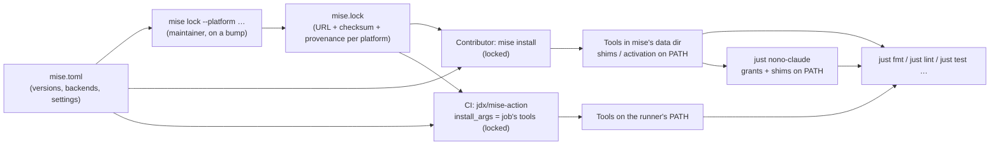

# Design Document: Tool Manager for Pinned Command-Line Tools

## Overview

Two new files at the repository root, `mise.toml` and `mise.lock`, become the
only place where the versions of the Pinned_Tools live. `mise.toml` names each
tool with an explicit backend and an exact version, and sets the five settings
the spike and this design found necessary; `mise.lock` is generated by
`mise lock` for the four Lockfile_Platforms and records each release archive's
URL, checksum and attestation provenance. Contributors run `mise install` once
per checkout; the settings make it a Locked_Install.

CI uses the same files through `jdx/mise-action`, pinned by commit, in the four
jobs that install tools today. Each job names the tools it needs, so the lint
job does not compile the Crate_Tools. The 20-line `gh` install function and its
`env` block in `ci-rust.yml`, `taiki-e/install-action` in `bnaclient.yml`, the
`curl` and `apt` install of hurl in `integration.yml`, and every
`extractions/setup-just` step disappear.

The `justfile` recipes are unchanged: they keep calling the tools by name from
the `PATH`. Only the two Agent_Recipes change: they grant the sandbox access to
mise's directories and put mise's shims first on the `PATH`, so an agent runs
`just lint` with the tools installed outside the sandbox (spike §5.12).

## Architecture



The trust chain is the one the spike tested (§5.3 to §5.5): at lock time mise
checks each archive's digest and its GitHub release attestation and records
both; at install time it compares each download with the recorded checksum and,
with `locked_verify_provenance`, verifies the recorded provenance again.

## Components and Interfaces

### `mise.toml` (new, repository root)

```toml
# Pinned command-line tools for contributors and CI (specs/0003-tool-manager).
# After changing a version, run:
#   mise lock --platform linux-x64,linux-arm64,macos-arm64,macos-x64
# and review the URLs of mise.lock.

[settings]
# Only GitHub is asked for release metadata and attestations.
use_versions_host = false
# Build crates from crates.io instead of unverified prebuilt binaries.
cargo.binstall = false
# Never install a missing tool behind a command's back.
auto_install = false
# Every install uses mise.lock only.
locked = true
# Check the attestations mise.lock records again at every install.
locked_verify_provenance = true

[tools]
"github:casey/just" = "1.59.0"
"github:crate-ci/typos" = "1.52.1"
"github:oxc-project/oxc" = { version = "0.78.0", version_prefix = "oxfmt_v" }
"github:rvben/rumdl" = "0.3.2"
"github:Orange-OpenSource/hurl" = "8.1.0"
"cargo:bacon" = "3.26.0"
"cargo:sea-orm-cli" = "2.0.4"
"cargo:cargo-progenitor" = "0.16.0"
```

Why each choice (Requirement 1):

- **Explicit backends** (1.2): the registry short names install typos with no
  attestation check and oxfmt as an npm package that needs Node.js (spike
  §5.10). `oxfmt` lives in the `oxc-project/oxc` repository under `oxfmt_v*`
  tags, hence `version_prefix`; no `asset_pattern`, which once locked the macOS
  archive for every platform (spike §5.3).
- **`use_versions_host = false`**: only GitHub is contacted; no request logs or
  install statistics go to `mise-versions.jdx.dev` (spike §5.10, decided while
  specifying).
- **`cargo.binstall = false`**: without it, sea-orm-cli comes from a prebuilt
  archive with no check (spike §5.6).
- **`auto_install = false`**: by default `mise exec` installs every missing tool
  of the configuration, compiling the Crate_Tools. Measured while designing
  (2026-11-11, mise 2026.11.5, scratch directories): after
  `mise install --locked github:crate-ci/typos github:casey/just`, a
  `mise exec -- typos --version` installed the six other tools. With
  `auto_install = false`, `mise exec -- rumdl --version` warns
  `… is not installed and auto-install is disabled …`, names the
  `mise install github:rvben/rumdl@0.3.2` command, and installs nothing
  (Requirement 2.7). This keeps an agent in nono from trying to install, and a
  CI job from installing more than its tools. mise then looks for the tool on
  the `PATH`: it fails when there is no other copy (Requirement 2.8) and runs
  the other copy when there is one; no setting makes it strict (found while
  implementing, `findings.md` §1.2).
- **`locked = true`**: every `mise install` is a Locked_Install, with or without
  `--locked`. Measured while designing: a plain `mise install` with a checksum
  altered in `mise.lock` fails with `Checksum mismatch`; `mise lock` still
  re-locks after a version bump (typos 1.52.1 → 1.52.0: exit 0, new URL and
  checksum for each platform, stale entry pruned).
- **`locked_verify_provenance = true`** (added while implementing, Requirement
  2.3, `findings.md` §1.1): when `mise.lock` has a checksum, `mise install`
  checks the checksum only and skips the attestation it recorded at lock time.
  With the setting, the install log shows
  `✓ GitHub artifact attestations verified` for oxfmt, rumdl, typos and hurl;
  just, with no recorded provenance, installs on its checksum.

### `mise.lock` (new, generated, repository root)

Generated by `mise lock --platform linux-x64,linux-arm64,macos-arm64,macos-x64`
(about 7.5 s for the eight tools), never edited by hand. Lockfile format
version 4. For each Release_Tool and platform it records `url`, `url_api`,
`checksum` (`sha256:…`) and, for the Attested_Tools,
`provenance = "github-attestations"`; for each Crate_Tool, the version only.
Expected archives per platform (spike §5.6d):

| Tool  | Linux                                            | macOS                              |
| ----- | ------------------------------------------------ | ---------------------------------- |
| just  | `just-1.59.0-<arch>-unknown-linux-musl.tar.gz`   | `…-apple-darwin.tar.gz`            |
| typos | `typos-v1.52.1-<arch>-unknown-linux-musl.tar.gz` | `…-apple-darwin.tar.gz`            |
| oxfmt | `oxfmt-<arch>-unknown-linux-gnu.tar.gz`          | `oxfmt-<arch>-apple-darwin.tar.gz` |
| rumdl | `rumdl-v0.3.2-<arch>-unknown-linux-gnu.tar.gz`   | `…-apple-darwin.tar.gz`            |
| hurl  | `hurl-8.1.0-<arch>-unknown-linux-gnu.tar.gz`     | `…-apple-darwin.tar.gz`            |

### `.github/workflows/ci-rust.yml` (lint job)

The `extractions/setup-just` step (line 15) and the "Install oxfmt, rumdl and
typos" step with its `env` block (lines 16-41) are replaced by:

```yaml
- uses: jdx/mise-action@b44d12e7d0d8ee7461bb893e1b1993500433185b # v5.2.7
  with:
    version: 2026.11.5
    install_args: >-
      github:casey/just github:crate-ci/typos github:oxc-project/oxc
      github:rvben/rumdl
```

`just lint` stays the next step. The `test` and `build` jobs are unchanged.

### `.github/workflows/bnaclient.yml` (test job)

`extractions/setup-just` (line 24) and `taiki-e/install-action` (lines 28-31)
are replaced by one `jdx/mise-action` step, placed **after**
`dtolnay/rust-toolchain@nightly` because `cargo-progenitor` is built with the
toolchain on the `PATH`:

```yaml
- uses: jdx/mise-action@b44d12e7d0d8ee7461bb893e1b1993500433185b # v5.2.7
  with:
    version: 2026.11.5
    install_args: github:casey/just cargo:cargo-progenitor
```

The job's `defaults.run.working-directory: bnaclient` does not apply to a `uses`
step; mise finds `mise.toml` from the workspace root, and the later `run` steps
in `bnaclient/` find the tools on the `PATH`. Building cargo-progenitor from
source replaces the prebuilt download of `taiki-e/install-action`; the action's
cache (on by default) keeps later runs short.

### `.github/workflows/integration.yml` (test and schema jobs)

- `test`: `extractions/setup-just` (line 42) and the "Install HURL" step (lines
  43-47) are replaced by a `jdx/mise-action` step with
  `install_args: github:casey/just github:Orange-OpenSource/hurl`. The job keeps
  `runs-on: ubuntu-24.04`; its comment (line 17) becomes "Hurl needs libxml2,
  which Ubuntu 26.04 no longer provides": the archive mise installs links the
  system `libxml2.so.2` like the `.deb` did (spike §5.6d).
- `schema`: `extractions/setup-just` (line 138) is replaced by a
  `jdx/mise-action` step with `install_args: github:casey/just`.

All `jdx/mise-action` steps use the same commit and `version: 2026.11.5`, and
the default `github_token` (the job's token, which avoids GitHub's anonymous
rate limit). The action runs `mise install` with `--locked` itself when
`mise.lock` exists (spike §5.13), and `locked = true` makes it locked anyway.

### `justfile` (Agent_Recipes)

Three variables resolve mise's directories as mise does: its own environment
variable first, then the XDG variable, then the default under the home directory
(`~/.local/share/mise`, `~/.config/mise`, `~/.local/state/mise`, the locations
the spike observed on macOS and Linux):

```just
# mise's directories, for the nono recipes (specs/0003-tool-manager).
mise_data := env("MISE_DATA_DIR", env("XDG_DATA_HOME", home_directory() / ".local/share") / "mise")
mise_config := env("MISE_CONFIG_DIR", env("XDG_CONFIG_HOME", home_directory() / ".config") / "mise")
mise_state := env("MISE_STATE_DIR", env("XDG_STATE_HOME", home_directory() / ".local/state") / "mise")
```

The two recipes (lines 194-204) become:

```just
# Use nono sandbox for Claude, with the tools installed by mise.
nono-claude profile="pfb-claude":
    mkdir -p "{{ mise_data }}" "{{ mise_config }}" "{{ mise_state }}"
    PATH="{{ mise_data }}/shims:$PATH" nono run \
    --allow-cwd \
    --profile {{ profile }} \
    --read "{{ mise_data }}" \
    --read "{{ mise_config }}" \
    --allow "{{ mise_state }}" \
    -- claude

# Use nono sandbox for Claude -- restricted internet, skip-permissions, with the tools installed by mise.
nono-claude-danger profile="pfb-claude":
    mkdir -p "{{ mise_data }}" "{{ mise_config }}" "{{ mise_state }}"
    PATH="{{ mise_data }}/shims:$PATH" nono run \
    --allow-cwd \
    --profile {{ profile }} \
    --read "{{ mise_data }}" \
    --read "{{ mise_config }}" \
    --allow "{{ mise_state }}" \
    -- claude --dangerously-skip-permissions
```

- Read access to the data directory covers the installs and the shims; read
  access to the configuration directory covers the contributor's
  `trusted_config_paths`; write access to the state directory lets mise record a
  new checkout in `tracked-configs` (spike §5.12).
- `mkdir -p` makes Requirement 4.5 hold without depending on how nono treats a
  missing path, which the spike did not test (its own `--allow` flags for
  missing or existing paths did not reach the session, spike §5.12). The
  directories are mise's own, so creating them empty is harmless.
- The shims come ahead of the contributor's `PATH` (nono adds its own helper
  directory, holding only `open` and `nono-open-url-helper`, in front of them:
  `findings.md` §2.4), so the agent gets the pinned tools whatever the
  contributor's shell setup; outside a trusted checkout, a shim fails instead of
  running an unpinned tool. mise creates shims for installed tools only, so a
  Pinned_Tool the contributor has not installed resolves to the next copy on the
  `PATH`, if any (`findings.md` §1.2).
- `nono-claude-login` is unchanged: logging in needs no tool.
- Whether `nono run` accepts several `--read` flags and passes the `PATH` of its
  caller to the sandboxed process is checked once in a real session (task 4).

### `.github/CONTRIBUTING.md`

A "Local tools" section after "General guidelines" (Requirement 6):

- Prerequisites: mise (link to its installation guide), version 2026.11.5 or
  newer; a Rust toolchain (for bacon, sea-orm-cli and cargo-progenitor); on
  Linux, `libxml2` for hurl; `gh auth login` or `GITHUB_TOKEN` to avoid GitHub's
  anonymous rate limit.
- Setup: trust the checkout (`mise trust`), or once for every checkout under a
  folder, `trusted_config_paths` in `~/.config/mise/config.toml`; then
  `mise install`; then put the tools on the `PATH` with `mise activate` (shell
  hook) or mise's shims directory. Mention that `just nono-claude` does the
  latter for agents. Run `mise install` again after pulling a change to
  `mise.toml`: a tool that is not installed falls back to any other copy on the
  `PATH`, with only a warning from `mise exec`.
- What it protects against: checksums for every archive, GitHub release
  attestations for oxfmt, rumdl, typos and hurl; just is checked by checksum
  only; the cargo tools are built from crates.io.
- Bumping a tool: edit `mise.toml`, run
  `mise lock --platform linux-x64,linux-arm64,macos-arm64,macos-x64`, check that
  every `url` in the diff names the right platform, then `mise install` and
  `just lint`.

### `CLAUDE.md`

Lines 44-47: "on the `PATH`, at the versions pinned in the `env` block of
`.github/workflows/ci-rust.yml`" becomes "on the `PATH`, at the versions pinned
in `mise.toml` (installed with `mise install`, see `.github/CONTRIBUTING.md`)".
The sentence on CI (lines 40-42) keeps saying CI runs `just lint`.

## Data Models

No runtime data. The two files above are the only new data: `mise.toml`
(hand-written TOML) and `mise.lock` (TOML generated by mise, format version 4).

## Correctness Properties

1. **One source of versions**: outside `specs/` and `CHANGELOG.md`, a
   Pinned_Tool version string appears only in `mise.toml` and `mise.lock`.
2. **Every platform is locked**: for each Release_Tool, `mise.lock` has exactly
   the four Lockfile_Platforms, each with a `checksum`, and each `url` names
   that platform's target (`linux` and `x86_64`/`aarch64`, or `apple-darwin`),
   never another platform's archive.
3. **Attested tools stay attested**: each Attested_Tool has
   `provenance = "github-attestations"` on every platform.
4. **No unlocked install**: no install by contributors or CI bypasses
   `mise.lock` (`locked = true`, and the action's `--locked`).
5. **No silent install**: no command run through mise installs a tool
   (`auto_install = false`).
6. **One installer in CI**: no workflow installs a Pinned_Tool except through
   `jdx/mise-action`.
7. **Agents read, never write, the tools**: the Agent_Recipes grant read access
   to the data and configuration directories and write access only to the state
   directory.

## Error Handling

| Situation                                           | Behavior                                                                                                                                        |
| --------------------------------------------------- | ----------------------------------------------------------------------------------------------------------------------------------------------- |
| Archive does not match `mise.lock`                  | `mise install` fails with `Checksum mismatch`, nothing installed for that tool; CI job fails at the action                                      |
| Tool, platform or checksum missing from `mise.lock` | `mise install` fails naming the tool and platform, with the hint to run `mise lock`                                                             |
| Recorded attestation cannot be verified             | Install fails (the lockfile requires the provenance)                                                                                            |
| Checkout not trusted                                | mise refuses the configuration (`… are not trusted`); the contributor runs `mise trust`                                                         |
| Tool not installed, run through mise                | Nothing installed; `mise exec` warns naming the tool and the install command, then runs the next copy on the `PATH` or fails when there is none |
| Tool not on the `PATH`, run by a recipe             | The shell's `command not found`, non-zero exit (unchanged)                                                                                      |
| hurl on Linux without `libxml2`                     | `libxml2.so.2: cannot open shared object file`; documented prerequisite                                                                         |
| GitHub anonymous rate limit                         | mise's API error; documented fix: `gh auth login` or `GITHUB_TOKEN`                                                                             |

## Integration

- `justfile`: only the Agent_Recipes and three new variables change; every other
  recipe keeps calling its tools by name (Requirement 3.1).
- `lambdas/tests/justfile` is unchanged: `hurl` and `sea-orm-cli` come from the
  `PATH`.
- `lambdas/README.md`: its "Remark" told contributors to
  `cargo binstall bacon@3.16.0 hurl@7.0.0 just@1.42.4 sea-orm-cli@1.1.1`; it now
  points to the "Local tools" section of `.github/CONTRIBUTING.md` (found by the
  spec review, Requirement 1.6).
- `.github/dependabot.yml` already updates GitHub Actions weekly, so it will
  propose new commits of `jdx/mise-action`; the `version:` input and the tool
  versions stay manual (version bumps are out of scope).
- `.gitignore`: nothing to add; mise writes nothing in the repository except
  `mise.lock`.
- The `npx` generators keep using the Node.js on the machine or the runner.

## Testing Strategy

There is no Rust code; each requirement is checked by a command, recorded in
`findings.md` during implementation.

- **Configuration** (1.1-1.5): `mise lock` exit 0; a script over `mise.lock` (in
  the scratch directory, not committed) checks properties 2 and 3: four
  platforms per Release_Tool, a checksum each, the URL's target matching the
  platform, provenance for the Attested_Tools.
- **Single source** (1.6, property 1, 5.6): `git grep` for each tool's name
  followed by any version (not only the pinned one, which missed the stale
  `cargo binstall` line of `lambdas/README.md`) and for `setup-just`,
  `install-action`, `gh release download`, `HURL_VERSION`, outside `specs/`,
  `CHANGELOG.md`, `mise.toml` and `mise.lock`, finds nothing but the matches
  task 6 lists.
- **Contributor install** (2.1-2.6, 3.2): with mise's directories pointed at
  empty scratch folders, `mise install` installs the eight tools at their
  versions (`--version` of each), then `just lint` exits 0. Negative checks on a
  scratch copy: an altered checksum, a removed checksum, a removed platform
  entry each make `mise install` fail with nothing installed (as in spike §5.5).
- **No silent install** (2.7, 2.8): with only some tools installed and no other
  copy of a missing tool on the `PATH`, `mise exec` warns naming it and fails,
  and the shell finds no shim for it; the data directory is unchanged.
- **Recipes** (3.1, 3.3): `git diff` shows no recipe change other than the
  Agent_Recipes; with the tools off the `PATH`, `just lint` fails (exit 127, as
  recorded in `specs/0002-rust-tooling/findings.md` §2.2).
- **Agents** (4.1-4.5): one real session started with `just nono-claude` in a
  trusted checkout: inside it, `which typos` names the shim and `just lint`
  exits 0; then once with a mise directory removed, the recipe still starts the
  sandbox. `just --dry-run nono-claude` shows the flags (4.1, 4.2, 4.4).
- **CI** (5.1-5.7): the pull request's runs of `ci-rust`, `bnaclient` and
  `integration` pass; each job's log shows only its tools installed, from
  `mise.lock`. The failure path (5.5) relies on the action failing when
  `mise install` fails, shown locally by the negative checks; a CI run with a
  broken lockfile is optional and needs the maintainer's approval before any
  push.
- **Documentation** (6.1-6.4): review against the criteria; `just lint` passes
  on the changed Markdown.

## Deployment Considerations

- No runtime, Lambda, database or environment variable change.
- Contributors must install mise (2026.11.5 or newer) and run `mise install`
  once per checkout before `just fmt`, `just lint` or the tests; the pull
  request description says so.
- The first CI run of each job builds cargo-progenitor (bnaclient) and fills the
  action's cache; later runs restore it.
- Rollback: revert the commit; the previous install steps come back with it.

## Dependencies

| Dependency       | Version                                                   | Role                              | Integrity before use                                         |
| ---------------- | --------------------------------------------------------- | --------------------------------- | ------------------------------------------------------------ |
| mise             | 2026.11.5 (CI pin; contributors this or newer)            | Tool manager                      | CI: the action checks mise's minisign-signed checksums       |
| jdx/mise-action  | v5.2.7, commit `b44d12e7d0d8ee7461bb893e1b1993500433185b` | Installs mise and the tools in CI | Pinned by commit                                             |
| oxfmt            | 0.78.0 (`oxc-project/oxc`, tag `oxfmt_v0.78.0`)           | Markdown formatter                | Lockfile checksum + GitHub release attestation               |
| rumdl            | 0.3.2 (`rvben/rumdl`)                                     | Markdown linter                   | Lockfile checksum + GitHub release attestation               |
| typos            | 1.52.1 (`crate-ci/typos`)                                 | Spellchecker                      | Lockfile checksum + GitHub release attestation               |
| hurl             | 8.1.0 (`Orange-OpenSource/hurl`)                          | API tests                         | Lockfile checksum + GitHub release attestation               |
| just             | 1.59.0 (`casey/just`)                                     | Command runner                    | Lockfile checksum (GitHub API digest; release not immutable) |
| bacon            | 3.26.0 (crates.io)                                        | `just debug-axum`                 | `cargo install --locked` from crates.io                      |
| sea-orm-cli      | 2.0.4 (crates.io)                                         | Migrations, entity generation     | `cargo install --locked` from crates.io                      |
| cargo-progenitor | 0.16.0 (crates.io)                                        | `bnaclient` generation            | `cargo install --locked` from crates.io                      |
