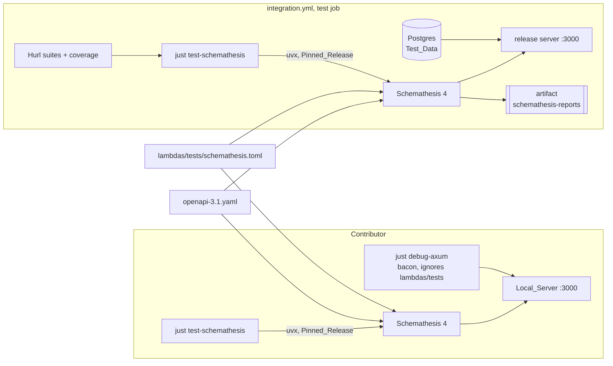

# Design Document: Property-Based API Testing with Schemathesis

## Overview

The feature has three parts. First, the `axum-debug` job of `bacon.toml` ignores
`lambdas/tests/`, so the Dev_Server no longer restarts when a test run writes
there (Requirement 1). Second, Schemathesis moves from a pinned Python project
to a single `uvx` call in `lambdas/tests/justfile`, with its settings in a new
`lambdas/tests/schemathesis.toml`; the run tests every operation of
`openapi-3.1.yaml` with Schemathesis 4's defaults made explicit: every check,
valid and invalid inputs, and the examples, coverage, fuzzing and stateful
phases (Requirements 2 and 3). Third, the integration workflow runs that recipe
after the Hurl suites and uploads its reports (Requirement 5).

Between the second and the third part, the first runs of Schemathesis 4 are
triaged: each Finding is either a defect, fixed in the API or in its `utoipa`
annotations with a Hurl request that reproduces it, or a false positive,
excluded in `schemathesis.toml` with its reason (Requirement 4). How many
Findings Schemathesis 4 reports is unknown: the sandbox of the investigation
could not reach PyPI, and only Schemathesis 3.39.5 ran, which passed every check
(requirements, Introduction).

Nothing changes in the API itself apart from the fixes, and nothing changes in
production.

## Architecture



The contributor and CI run the same recipe, so they share the Pinned_Release,
the Schemathesis_Config and the specification. Only the server differs: the
Dev_Server (debug build, watched by bacon) locally, the release build in CI.

## Components and Interfaces

### `bacon.toml`

The `axum-debug` job gains one line:

```toml
[jobs.axum-debug]
# ...
on_change_strategy = "kill_then_restart"
ignore = ["lambdas/tests"]
```

bacon watches each package's `src`, `tests`, `benches` and `examples`
directories; `lambdas/tests/` is the `tests` directory of the `lambdas` package.
In bacon 3.26.0 a job's `ignore` takes glob patterns resolved against the
project root, and since 3.23.0 a folder pattern also ignores its content
(bacon's changelog, fix #438). The other jobs keep watching `lambdas/tests/`,
where the Rust tests of `hurl-coverage` live. The change is in the working tree
since 2026-11-13; the first task commits it.

### `lambdas/tests/justfile`

Two variables hold the Pinned_Release; one recipe replaces `setup`,
`test-localhost-schemathesis` and `test-staging-schemathesis`:

```just
# Schemathesis release run by uvx, and the date after which uv considers no
# package when resolving its dependencies: both change together.
schemathesis := "schemathesis@4.33.4"
schemathesis_exclude_newer := "2026-11-13"

# Settings are in schemathesis.toml. Needs uv, and the API on localhost:3000.
# Run Schemathesis against the local server.
test-schemathesis:
    uvx --python 3.13 --exclude-newer {{ schemathesis_exclude_newer }} \
      {{ schemathesis }} run {{ top_dir }}/openapi-3.1.yaml
```

- `schemathesis@4.33.4` is the latest release on 2026-11-13 (published on
  2026-11-12). If a newer 4.x release is out when the feature is implemented,
  the task takes it, with `schemathesis_exclude_newer` the day after its
  publication.
- `--exclude-newer` limits the resolution to packages uploaded before the date,
  so two resolutions of the same Pinned_Release pick the same dependency
  versions (Requirement 2.3) without a lockfile. `--python 3.13` keeps the
  interpreter of today's `.python-version` (Schemathesis requires 3.11 or
  later), which uv downloads if it is missing.
- The recipe runs from `lambdas/tests`, the justfile's directory, where
  Schemathesis finds `schemathesis.toml` by itself.
- The comment order follows the convention of the justfiles: the summary that
  `just --list` shows comes last.

### `lambdas/tests/schemathesis.toml` (new)

```toml
#:schema https://raw.githubusercontent.com/schemathesis/schemathesis/master/src/schemathesis/config/schema.json

# The local server: the Dev_Server, or the release build in CI.
base-url = "http://localhost:3000"

# Report every failure of a scenario, not only the first.
continue-on-failure = true

# Schemathesis 4's defaults, stated so that a new default cannot weaken the run.
[generation]
mode = "all"

[checks]
enabled = true

[phases]
examples.enabled = true
coverage.enabled = true
fuzzing.enabled = true
stateful.enabled = true

[reports]
directory = "schemathesis-report"
junit.enabled = true
html.enabled = true

# Excluded findings, one block each, with the reason they are false positives:
# [[operations]]
# include-name = "POST /cities"
# checks.positive_data_acceptance.enabled = false  # reason
```

- No `max-failures`: a run tests every operation (Requirement 3.4), and
  `continue-on-failure` reports every failure within a scenario.
- No `generation.max-examples`: the default (100 cases per operation in the
  fuzzing phase) is measured in CI before any cap is considered.
- `[[operations]]` blocks disable a check for the matching operations; an
  Excluded_Finding names its operation with `include-name` and its check, with a
  comment giving the reason (Requirement 3.6).

### `.gitignore`

Two new entries, so that a run leaves `git status` unchanged (Requirement 3.5):

```gitignore
lambdas/tests/.schemathesis
lambdas/tests/schemathesis-report
```

`.schemathesis/` holds Schemathesis' cache and the crash files `st replay`
reads; `schemathesis-report/` holds the JUnit and HTML reports.
`lambdas/tests/.venv` stays listed, so a contributor's old virtual environment
stays ignored until they delete it.

### Removed files

`lambdas/tests/pyproject.toml`, `lambdas/tests/uv.lock` and
`lambdas/tests/.python-version` are deleted (Requirement 2.5). Nothing else
reads them: the `setup` recipe and the two Schemathesis recipes are the only
users.

### `.github/workflows/integration.yml`

The `test` job installs uv, and runs the recipe and uploads its reports after
the coverage summary; the commented-out step is removed (Requirement 5.5):

```yaml
- uses: astral-sh/setup-uv@68559e99cc807c1eb7e9238fd43a15bba460eec2 # v10.3.3
  with:
    version: "0.13.8"
# ...
# Schemathesis writes random rows, so it runs after the Hurl suites, which
# need the test data as loaded. Like the coverage check, it also runs when
# an earlier step failed.
- name: Run Schemathesis
  if: ${{ !cancelled() }}
  working-directory: lambdas/tests
  run: just test-schemathesis
- name: Upload the Schemathesis reports
  if: ${{ !cancelled() }}
  uses: actions/upload-artifact@cf430e030ddbb5b0abf93d22962f4752f3646cd9 # v7.0.2
  with:
    name: schemathesis-reports
    path: lambdas/tests/schemathesis-report
    if-no-files-found: warn
```

- `astral-sh/setup-uv` v10.3.3 (2026-10-28) is pinned by commit, like every
  action of the repository; `version` pins uv itself to the version used to
  develop the feature (0.13.8 on 2026-11-13).
- The step reports under the job's name, `test`, a required check of `main`, so
  a failure blocks the merge (Requirement 5.2).
- The upload is a separate artifact from `integration-reports`, because
  `just test` deletes `reports/` and the two directories have different
  lifetimes.

### Documentation

- `lambdas/tests/README.md`: a "Schemathesis" section with the prerequisites
  (uv, the Local_Server on the Test_Data), the recipe, what the run checks,
  where the reports and the crash files go, `st replay` through the same `uvx`
  command to reproduce a failure, the CI step, and that the database must be
  reloaded with `just db-seed` before running the Hurl suites again
  (Requirements 6.1, 6.2).
- `lambdas/README.md`: uv among the requirements, and `just test-schemathesis`
  in "Terminal 2" with the Hurl suites (Requirement 6.3).
- `.github/CONTRIBUTING.md`: uv as the prerequisite of Schemathesis, next to the
  tools mise installs (Requirement 6.4).
- `CLAUDE.md`: `just test-schemathesis` replaces
  `just test-localhost-schemathesis` in the integration test commands, with uv
  as its prerequisite (Requirement 6.4).

## Data Models

No data model changes. Schemathesis writes random rows into the database it
tests (cities, submissions, pipelines, ratings, prices), which is why it runs
after the Hurl suites in CI and why the documentation asks for `just db-seed`
before the Hurl suites locally.

The only new data are files outside version control: the reports in
`schemathesis-report/` (`junit-<timestamp>.xml`, `html-<timestamp>/`) and the
cache and crash files in `.schemathesis/`.

## Correctness Properties

1. **One version**: `4.33.4` (or the version chosen) and the exclusion date
   appear only in `lambdas/tests/justfile`; the workflow and the documentation
   name the recipe, not the version.
2. **Same run everywhere**: contributors and CI run the same recipe with the
   same Schemathesis_Config against the same specification and the same
   Test_Data.
3. **Exit status**: the recipe exits `0` exactly when every enabled check passes
   on every operation; it exits non-zero on any Finding that is not excluded, on
   a server it cannot reach, and on a run that tested nothing.
4. **No residue**: after any run, `git status` is unchanged.
5. **Server undisturbed**: while the Dev_Server runs, no file operation under
   `lambdas/tests/` changes the server process.
6. **Hurl unaffected in CI**: the Hurl suites and the coverage check run on the
   Test_Data as loaded, before Schemathesis writes anything.
7. **Exclusions are explained and narrow**: each `[[operations]]` block names
   one operation and disables only the checks it must, with its reason.

## Error Handling

| Condition                                      | Behavior                                                                                                                                                       |
| ---------------------------------------------- | -------------------------------------------------------------------------------------------------------------------------------------------------------------- |
| A check fails                                  | Schemathesis reports the Finding with a cURL command to reproduce it and exits `1`; the CI job fails, the reports are uploaded.                                |
| The server is not running                      | Every request fails to connect; the run reports a Network Error per operation and exits `1` (observed with 4.33.4 on 2026-11-13: 26 operations errored).       |
| uv is not installed                            | The shell reports `uvx: command not found`; the recipe exits `127`. The READMEs name uv as the prerequisite.                                                   |
| PyPI is unreachable                            | `uvx` fails to resolve the Pinned_Release and exits non-zero. In the nono sandbox, PyPI is blocked unless `pypi.org` and `files.pythonhosted.org` are allowed. |
| A filter or exclusion disables every operation | Schemathesis exits `2` ("a run that tested nothing").                                                                                                          |
| An earlier CI step failed                      | Schemathesis still runs (`!cancelled()`), so one run reports both.                                                                                             |

## Integration

- **Triage of the Findings** (Requirement 4). Each Finding is classified, then
  handled in its own commit, as the team does for every fix:
  - a defect of the API (`lambdas/src/core/resource/**`): the fix, a Hurl
    request in `lambdas/tests/endpoints/` or `scenario/` that fails without it,
    and a `CHANGELOG.md` entry under `[Unreleased]` when a client can see the
    change;
  - a defect of the specification (a `utoipa` annotation that does not describe
    the response): the annotation fix, `just generate` to regenerate
    `openapi-3.1.yaml`, `openapi-3.0.yaml` and `bnaclient`, and the Hurl
    request;
  - a false positive: an `[[operations]]` block in `schemathesis.toml` with its
    reason.

  Every new status code a fix documents needs a Hurl request before
  `just coverage` passes again (`lambdas/tests/README.md`, Coverage). Each
  Finding and its outcome are recorded in `findings.md` during implementation.

- **Hurl suites**: unchanged. Locally, a Schemathesis run adds rows that the
  Hurl suites do not expect; `just db-seed` restores the Test_Data.
- **`specs/0001-hurl-api-coverage`** stated that response shapes are not
  validated against the schema "until Schemathesis is fixed"; this feature
  closes that gap. The past spec stays as written.
- **Root `justfile`**: unchanged. Its `test` meta task runs the Rust tests only,
  as Schemathesis needs a running server.

## Testing Strategy

- **Requirement 1**: with the Dev_Server running, the probe of the
  investigation: create, modify and delete a file under `lambdas/tests/` (and
  recreate `reports/`), polling `GET /health` and the server's PID every 100 ms
  for 8 s; the PID must not change. Then change a file under `lambdas/src/` and
  see the PID change. Then run `just test-smoke-public localhost`,
  `just test localhost` and `just test-schemathesis` in a row.
- **Requirement 2**: resolve the Pinned_Release twice with empty uv caches
  (`UV_CACHE_DIR` pointing at two new directories) and compare the installed
  distributions (`uvx … --from <release> python -c` listing
  `importlib.metadata.distributions()`); they must be identical. `git ls-files`
  must no longer list the three deleted files, nor `just --list` the three
  removed recipes.
- **Requirement 3**: the run's output lists 26 operations, the four phases and
  every check; the JUnit and HTML reports exist in `schemathesis-report/`;
  `git status` is clean afterwards. Negative test: change a `utoipa` annotation
  locally so that a response no longer matches (for example, a required field
  removed from the response), regenerate `openapi-3.1.yaml`, and check that the
  recipe fails, then revert. Run the recipe with the server stopped and check
  the non-zero exit status.
- **Requirement 4**: after the triage, the recipe passes on a fresh
  `just db-seed`, and `just test localhost` and `just coverage` pass on another
  fresh `just db-seed`. Each fix's Hurl request is checked to fail without the
  fix.
- **Requirement 5**: the pull request's integration run shows the Schemathesis
  step, passing, and the `schemathesis-reports` artifact. Its duration is
  recorded in `findings.md` (Out of scope: no cap up front).
- **Requirement 6**: a review of the four documents, and `just lint`.

## Deployment Considerations

- No deployment and no runtime change: the fixes ship with the next release,
  through the usual staging and production workflows.
- CI downloads uv, Python 3.13 and the Schemathesis release from PyPI on each
  run of the integration workflow; the step needs network access to `pypi.org`
  and `files.pythonhosted.org`.
- Agents in the nono sandbox (`pfb-claude` profile) cannot reach PyPI, and uv's
  tool directory (`~/.local/share/uv/tools`) is read-only there, as the
  investigation found: running the recipe from an agent session needs
  `--allow-domain pypi.org --allow-domain files.pythonhosted.org` and a writable
  `UV_TOOL_DIR`, or a run outside the sandbox.
- The integration job gets longer by the time of one run; it is measured on the
  pull request.

## Dependencies

| Dependency           | Version                                                                                                                  | Where                                                |
| -------------------- | ------------------------------------------------------------------------------------------------------------------------ | ---------------------------------------------------- |
| Schemathesis         | 4.33.4 (MIT), or the latest 4.x at implementation                                                                        | `lambdas/tests/justfile`, through `uvx`              |
| uv                   | any recent version locally; 0.13.8 in CI                                                                                 | contributor prerequisite; `astral-sh/setup-uv` in CI |
| `astral-sh/setup-uv` | v10.3.3, commit `68559e99cc807c1eb7e9238fd43a15bba460eec2`                                                               | `integration.yml`                                    |
| Python               | 3.13, downloaded by uv when missing                                                                                      | `--python 3.13` in the recipe                        |
| bacon                | 3.26.0, already pinned in `mise.toml`; job `ignore` exists since 3.3.0, folder patterns cover their content since 3.23.0 | `bacon.toml`                                         |

## Open Questions

- **The Findings of Schemathesis 4**: their number and kind decide the size of
  the triage task; none could be observed before implementation. The pinned
  `uvx` call itself was checked on 2026-11-13: it resolves 27 packages, and
  selects the 26 operations of `openapi-3.1.yaml`.
- **Stateful links**: Schemathesis 4 infers links from response schemas and
  `Location` headers. Whether it finds links between the API's operations (for
  example `POST /cities/submissions` and
  `GET`/`PATCH /cities/submissions/{submission_id}`) is observed in the first
  run; adding OpenAPI links to the `utoipa` annotations is left for a follow-up
  if it finds none.
